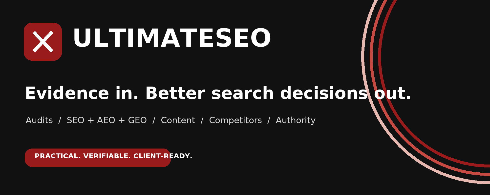

# UltimateSEO

**A professional AI SEO skill for evidence-led audits, practical strategy, useful content, and authorized implementation.**

UltimateSEO combines a local website crawler with structured SEO, AEO, GEO, entity, competitor, reputation, backlink, content, conversion, and reporting workflows. It is designed for consultants, agencies, business owners, and website teams who need inspectable evidence rather than generic checklists.

## Why UltimateSEO

- **Business-first analysis:** Understand offers, customers, markets, proof, and conversion goals before recommending tactics.
- **Evidence you can inspect:** Preserve page captures, source URLs, dates, coverage, failures, and uncertainty.
- **Actionable deliverables:** Connect each priority to affected pages, business impact, effort, and an acceptance check.
- **SEO + AI-search readiness:** Evaluate technical access, answer quality, entities, structured data, and source-worthiness without claiming guaranteed citations.
- **Real competitor selection:** Compare businesses with compatible offers and audiences rather than treating every search result as a competitor.
- **Conservative reputation research:** Separate verified links, mentions, owned sources, prospects, and unverified candidates.
- **Client-ready reporting:** Generate branded HTML and PDF reports from reviewed evidence.
- **Controlled implementation:** Stage authorized changes, preserve backups, verify results, and keep publishing separate from auditing.

## Quick start

### Requirements

- Python 3.10 or newer; Python 3.12 is recommended.
- Git for cloning the repository.
- Optional Chromium support for JavaScript rendering.
- Optional ReportLab support for PDF reports.

### Install the skill

Use the release skill archive with an assistant that accepts skill uploads, or follow the host-specific instructions in [the installation guide](docs/agent-installation.md).

For a local checkout:

```sh
git clone https://github.com/Ultimate-khan/ultimateseo.git
cd ultimateseo
python3 scripts/setup.py
```

On Windows, use `py -3` when appropriate. For a minimal HTTP-only runtime:

```sh
python3 scripts/setup.py --http-only
```

Confirm both skill registration and engine readiness; they are separate checks:

```sh
python3 scripts/run.py doctor
```

### Run the first audit

```sh
python3 scripts/run.py crawl https://example.com --include-www --out ../client-runs/example/site
```

Then ask your assistant:

```text
Use UltimateSEO to audit https://example.com.
Understand our offers, customers, markets, and business goal first.
Give me prioritized actions with affected pages, evidence, proposed changes,
acceptance checks, competitors, reputation findings, and a 30/60/90-day plan.
Clearly state anything you could not verify.
```

Keep client evidence outside the product repository.

## Common requests

### Focused technical review

```text
Use UltimateSEO to inspect https://example.com for crawlability, indexing signals,
canonicals, robots, sitemaps, internal links, metadata, structured data, and
JavaScript rendering. Show the affected URLs and a verification step for each fix.
```

### Content and AI-search readiness

```text
Use UltimateSEO to review our priority service pages. Identify the customer
questions we answer poorly, then draft improved titles, direct answers,
headings, supporting sections, internal links, and factual schema.
```

### Competitor research

```text
Use UltimateSEO to find up to five businesses with comparable services,
customers, and markets. Verify their pages, explain why each qualifies,
and turn relevant differences into actions for our website.
```

### Backlink and reputation plan

```text
Use UltimateSEO to research 15 relevant publishing or reputation opportunities.
Provide the destination, contribution idea, target page, eligibility checks,
link restrictions, and a realistic schedule. Keep prospects separate from
verified backlinks.
```

### Search Console review

```text
Use UltimateSEO to analyze this Search Console export. Separate queries from
pages, preserve the exported-row coverage, compare only compatible periods,
and recommend page-level reviews without inventing query-to-page relationships.
```

### Authorized implementation

```text
Use UltimateSEO to apply the approved changes to the specified pages.
Preserve the design and verified business facts, create backups, stay within
this scope, and show the applied changes and verification results.
```

## Engine commands

Use `python3 scripts/run.py` from the skill root, or the installed `ultimateseo` command.

| Command | Purpose |
|---|---|
| `doctor` | Check runtime, dependency, filesystem, browser, and optional target readiness |
| `crawl` | Capture bounded website evidence and technical observations |
| `profile` | Build a business profile from crawl evidence and reviewed context |
| `entity-review` | Inventory JSON-LD identities and review candidates |
| `discover` | Collect bounded search or supplied-source candidates |
| `competitors` | Classify reviewed candidate profiles using consistent criteria |
| `audit` | Consolidate evidence into structured findings |
| `audit-check` | Check whether a complete audit has the required stages and evidence |
| `backlinks` | Verify supplied source pages for target links and brand mentions |
| `reputation` | Produce a conservative, sample-based reputation assessment |
| `search-performance` | Analyze a supplied Search Console CSV offline |
| `lighthouse-review` | Review supplied Lighthouse lab JSON without confusing it with field data |
| `present` | Export reviewed HTML/PDF reports |
| `compare` | Compare two saved website snapshots |
| `edit` / `onsite` | Stage and apply reviewed changes within an authorized scope |

Run `python3 scripts/run.py --help` or a command's `--help` for current options.

## Evidence standard

Every material finding should include:

1. Affected URL or scope.
2. Observation, source, and capture date.
3. Fact, inference, or hypothesis classification.
4. Business impact and customer relevance.
5. Specific action and priority rationale.
6. Acceptance check, uncertainty, and coverage limits.

UltimateSEO does not treat search snippets as verified backlinks, lab scores as field performance, readiness as indexing, or sampled visibility as a whole-web measurement. It does not invent rankings, traffic, search volume, authority metrics, or AI citations.

## Project layout

```text
ultimateseo/
├── SKILL.md                 # Core agent workflow
├── src/                    # Local crawler, analysis and reporting engine
├── scripts/                # Setup, launch, validation and packaging tools
├── references/             # Evidence, crawler and capability references
├── playbooks/              # Focused SEO methods and deliverable templates
├── docs/                   # Host, operations and implementation guides
├── examples/               # Fictional practice inputs and local test site
└── assets/                 # UltimateSEO brand resources
```

## Privacy and permissions

The native engine stores evidence locally and makes network requests only for the authorized task and selected routes. AI hosts, optional connectors, Google services, and publishing platforms have their own data handling and permission models.

Auditing does not authorize website edits, deployment, account access, outreach, purchases, or external publication. Do not place credentials, private exports, or client reports in a public repository. See [permissions](docs/permissions.md) and [security](SECURITY.md).

## Development and validation

```sh
python3 scripts/validate_skill.py
python3 scripts/check_docs.py
python3 -m unittest discover -s tests
```

A format check is not proof of host registration, live website access, or a successful crawl. Test fixtures and example reports are fictional unless explicitly identified otherwise.

See the [3.0.0 release notes](CHANGELOG.md#300--ultimateseo-professionally-rebuilt) and [GitHub publishing guide](docs/development.md#publish-ultimateseo-to-github) for the release checklist and verification steps.

## License and attribution

UltimateSEO is a rebranded and revised edition of the open-source BeyondSEO project. The original MIT license and copyright notice are retained in [LICENSE](LICENSE). See [third-party notices](THIRD_PARTY_NOTICES.md) for dependency information.

**Created and maintained by Bilal Khan — Ultimate-khan.**
